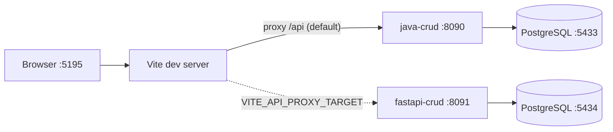

# faruk-base2

Template de engenharia com **Matt Pocock Skills** e exemplos de CRUD de **Product** em três stacks:

| Exemplo | Stack | Porta | README |
|---------|-------|-------|--------|
| [`examples/java-crud`](examples/java-crud) | Java 21, Spring Boot 4.1, PostgreSQL | API **8090** | [README](examples/java-crud/README.md) |
| [`examples/fastapi-crud`](examples/fastapi-crud) | Python 3.12, FastAPI, PostgreSQL | API **8091** | [README](examples/fastapi-crud/README.md) |
| [`examples/vue-crud`](examples/vue-crud) | Vue 3, Vuetify 3, Pinia, Axios | UI **5195** | [README](examples/vue-crud/README.md) |

Os três backends expõem o mesmo contrato REST (`/api/products`). O frontend Vue usa **Java (8090) como backend padrão** via proxy do Vite.

## Conteúdo do repositório

- **Skills** — Matt Pocock (`npx skills add mattpocock/skills`), lock em `skills-lock.json`
- **Setup agente** — `AGENTS.md`, `docs/agents/`, [`HELP-SKILLS.md`](HELP-SKILLS.md)
- **Exemplos** — CRUD Product com Docker, testes e documentação de domínio (`CONTEXT.md` + ADRs)

## Quick start — stack completa (Java + Vue)

```bash
# 1. Backend Java
cd examples/java-crud
docker compose up --build -d

# 2. Frontend Vue (outro terminal)
cd examples/vue-crud
npm install
npm run dev
```

| Serviço | URL |
|---------|-----|
| API Java | http://localhost:8090/api/products |
| Swagger | http://localhost:8090/swagger-ui/index.html |
| UI Vue | http://localhost:5195 |

O Vite faz proxy de `/api` → `http://localhost:8090` (configurável em `.env`).

## Quick start — backends isolados

**Java (Spring Boot):**

```bash
cd examples/java-crud && docker compose up --build -d
```

- API: http://localhost:8090/api/products
- Swagger: http://localhost:8090/swagger-ui/index.html

**FastAPI (alternativa):**

```bash
cd examples/fastapi-crud && docker compose up --build -d
```

- API: http://localhost:8091/api/products
- Swagger: http://localhost:8091/docs

Para apontar o Vue ao FastAPI: `VITE_API_PROXY_TARGET=http://localhost:8091` em `examples/vue-crud/.env`.

## Arquitetura dos exemplos



## Skills e workflow

Roteador de entrada: **`/ask-fmz`**. Guia completo: [`HELP-SKILLS.md`](HELP-SKILLS.md).

Fluxo formal usado nos exemplos:

```
/ask-fmz → /grill-with-docs → /to-spec → /to-tickets → /implement
```

Restaurar skills após clone:

```bash
npx skills experimental_install
```

## Documentação de domínio

| Exemplo | CONTEXT | ADRs |
|---------|---------|------|
| Java | [`examples/java-crud/CONTEXT.md`](examples/java-crud/CONTEXT.md) | [`docs/adr/`](examples/java-crud/docs/adr/) |
| FastAPI | [`examples/fastapi-crud/CONTEXT.md`](examples/fastapi-crud/CONTEXT.md) | [`docs/adr/`](examples/fastapi-crud/docs/adr/) |
| Vue | [`examples/vue-crud/CONTEXT.md`](examples/vue-crud/CONTEXT.md) | [`docs/adr/`](examples/vue-crud/docs/adr/) |

Artefatos de spec/tickets: `.scratch/<exemplo>-product-crud/`.
